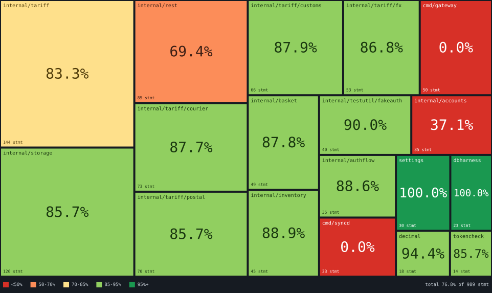

# js-covergrid

JavaScript coverage in one PR comment, drawn as a grid map: tiles sized by statements, coloured by coverage.

The action reads the `json-summary` file your coverage tool writes, renders it as a **Grid Map**, and
posts one pull request comment with the picture, the total, and the change since the base branch. The
Grid Map shows where the repository's tests are and aren't. Each tile's area is proportional to its
statement count.



It works with Vitest, Jest, nyc and c8. Vitest is recommended, not required.

## Grid Map image: `attachment-token`

GitHub comments can't embed an SVG directly, so the action uploads the Grid Map as a GitHub attachment,
the same as dragging an image into a comment. Only people who can read the repository can see it, and
it doesn't expire.

The upload needs a personal access token. `GITHUB_TOKEN` and GitHub App tokens are rejected. Use one of:

- a **fine-grained token** scoped to the repository with `Pull requests: Read and write`
- a **classic token** with the `repo` scope

The token's owner must have write access to the repository. Store the token as a secret:

```yaml
- uses: gringolito/js-covergrid@v1
  if: always()
  with:
    coverage-summary: coverage/coverage-summary.json
    attachment-token: ${{ secrets.COVERGRID_ATTACHMENT_TOKEN }}
```

The token is used only for the upload, which is attributed to its owner. `github-token` still posts the
comment.

Without `attachment-token`, the comment is posted without the image. Pull requests from forks get no
secrets, so they never upload. Their read-only `GITHUB_TOKEN` can't post the comment either.

## Prior art

[davelosert/vitest-coverage-report-action](https://github.com/davelosert/vitest-coverage-report-action)
posts table-style comments from `json-summary`. It has no picture, and you supply the baseline yourself
with `json-summary-compare-path`.

This action adds the Grid Map, and it finds the baseline for you: the base branch's last successful run
uploads it as an artifact, and the next pull request downloads it.

## Usage

This workflow works as-is. Save it as `.github/workflows/ci.yml`:

```yaml
name: CI

on:
  pull_request:
  push:
    branches: [main] # required: this is what produces the baseline

permissions:
  contents: read
  pull-requests: write # to post the comment
  actions: read # to read the baseline run's artifacts

jobs:
  test:
    runs-on: ubuntu-latest
    steps:
      - uses: actions/checkout@v5
      - uses: actions/setup-node@v5
        with:
          node-version: lts/*
          cache: npm
      - run: npm ci

      - run: npx vitest run --coverage
      - uses: gringolito/js-covergrid@v1
        if: always()
        with:
          coverage-summary: coverage/coverage-summary.json
          attachment-token: ${{ secrets.COVERGRID_ATTACHMENT_TOKEN }}
```

The file name doesn't matter. The baseline lookup finds the workflow it runs in.

And the coverage block in `vitest.config.ts`:

```ts
import { defineConfig } from 'vitest/config'

export default defineConfig({
  test: {
    coverage: {
      provider: 'v8', // or 'istanbul'
      reporter: ['text', 'json-summary'],
      include: ['src/**/*.{ts,tsx}'],
      reportOnFailure: true,
      thresholds: {
        statements: 80,
      },
    },
  },
})
```

Thresholds live in your test tool's config. The action gives no verdict and never fails the job on
coverage. See [ADR-0003](docs/adr/0003-the-test-tool-owns-the-gate.md).

**The `push` trigger is required.** The baseline is the Breakdown File from the most recent successful
run of this workflow on the base branch. A workflow that only runs on `pull_request` never produces one.
Nothing fails. The Grid Map still renders, but no PR ever shows a comparison against `main`.

The `permissions` block is required, and the action can't request permissions for you. Runs triggered
by `pull_request` from a **fork** get a read-only token regardless of this block, so the comment can't
be posted there. That is a GitHub rule.

The first run on a repository has no baseline, so its comment has no diff section. This is expected.
The second PR after a merge to `main` gets one.

### Set up your coverage tool

- **Set `coverage.include`.** Vitest 4 removed `coverage.all`. Without `include`, the report lists only
  the files the tests loaded, so untested files never appear as red tiles and the map looks better than
  it is.
- **Use Vitest 4 or later, or the `istanbul` provider.** Before v4 the `v8` provider remapped coverage
  through `v8-to-istanbul`, which the Vitest docs call inaccurate.
- **Set `reportOnFailure: true` and run the action with `if: always()`.** When tests fail, the test
  step stops the job. Without both, a failing run writes no summary or never reaches the action, and the
  pull request gets no comment.
- **Add `json-summary` to `coverage.reporter`.** It writes `coverage/coverage-summary.json`.

Other tools:

- **Jest:** `coverageReporters: ['json-summary']`. `collectCoverageFrom` is the equivalent of
  `coverage.include`.
- **nyc:** `--reporter=json-summary`, with `--all` and `--include` to count untested files.
- **c8:** `--reporter=json-summary`, with `--all` and `--include`.

**Statement counts differ between tools and providers.** Compare numbers within one repository on one
provider. If you switch provider, the next comparison against the baseline is unreliable, and the action
doesn't detect it.

**LCOV is out of scope.** It counts lines, not statements. See
[ADR-0002](docs/adr/0002-lcov-out-of-scope.md).

### `package-depth`

By default a tile is a folder: everything before the last `/` of a file path. `a/b` and `a/b/c` are two
separate tiles. On layouts with a folder per component or per function that gives many tiles.

`package-depth` folds deeper folders into their ancestor. It counts from the deepest folder every file
shares. When every file is under `app/javascript/`, depth 2 turns
`app/javascript/mastodon/features/ui/index.tsx` into `app/javascript/mastodon/features`. Tile names stay
full paths. Start at 1 or 2. The default `0` has no limit.

Changing the depth doesn't break the comparison with the baseline. See
[ADR-0004](docs/adr/0004-package-is-the-directory.md).

### Inputs

| Input | Default | What it does |
| --- | --- | --- |
| `coverage-summary` | `coverage/coverage-summary.json` | Path to the Istanbul `json-summary` file. |
| `github-token` | `${{ github.token }}` | Used for the baseline lookup, the artifact download, and the comment. |
| `base-branch` | the repository default branch | Where the baseline comes from. |
| `breakdown-artifact` | `coverage-breakdown` | Artifact name for the breakdown file. Changing it orphans every existing baseline. |
| `attachment-token` | none | Personal access token for uploading the Grid Map image. See [Grid Map image](#grid-map-image-attachment-token). |
| `package-depth` | `0` | Folders kept in a package name, counted from the deepest folder every file shares. `0` is no limit. See [`package-depth`](#package-depth). |

### Outputs

`total-coverage`, `total-statements`, `covered-statements`, `package-count`, `grid-map-path`,
`grid-map-url`.

## GitHub Enterprise Server

GitHub Enterprise Server doesn't run `actions/upload-artifact` v4 or later, so use the `ghes`
variant. It takes the same inputs, gives the same outputs, and uses the same tags:

```yaml
- run: npx vitest run --coverage
- uses: gringolito/js-covergrid/ghes@v1
  if: always()
  with:
    coverage-summary: coverage/coverage-summary.json
```

It differs from the main action in one step: the breakdown file is uploaded with
`upload-artifact@v3.2.1-node20`. Both variants fetch the baseline through the REST API, so neither needs
`download-artifact`. See [ADR-0009](docs/adr/0009-github-enterprise-server.md).

GHES serves `actions/upload-artifact` from its own bundled copy. The step is pinned to the
`v3.2.1-node20` commit (`c24449f3`, September 2024), so that copy has to include it. It does on any
instance whose `actions/upload-artifact` has the `v3.2.1-node20` tag.

Your runners and instance also need:

- **`node` on `PATH`.** Every script step runs it. GitHub-hosted images have it, but self-hosted
  runners often don't. Add `actions/setup-node` before this action if yours don't.
- **GitHub Connect or actions-sync**, so the runner can fetch this action.

GitHub Enterprise Server doesn't accept token uploads of user attachments, so the Grid Map image isn't
available there. `gh` refuses `--attach` on enterprise hosts for the same reason. The action still
tries `/api/uploads` in case a future GHES release adds it. When it's refused, the action warns and
posts the comment without the image.

## Reading a Grid Map

Each package is one tile. Tile **area** is the package's statement count, so big tiles are big
packages. Tile **colour** is the coverage band: red below 50%, orange to 70%, yellow to 85%, light green
to 95%, dark green above. Area is statements and colour is coverage, so the coloured share of the
picture is the repository's overall coverage.

For why the layout is flat, see [ADR-0005](docs/adr/0005-grid-map-geometry.md).

## Where the numbers come from

A converter, `src/convert-summary.js`, reads the coverage summary and writes the **breakdown file**: one
line per source file, `path;totalStatements;coveredStatements`, with paths relative to the workspace.
Every number comes from that file: the Grid Map, the total, the diff summary, and the impacted tables.
The baseline is the breakdown file from the base branch's last successful run. See
[ADR-0001](docs/adr/0001-coverage-summary-is-the-only-input.md).

The impacted tables list packages and files whose uncovered statement count changed, and new ones.
Entries that are fully covered now are left out. The total line still shows the gain.

## Development

There are no dependencies and no build step. Tests use `node:test`:

```bash
node --test test/*.test.js
```

The picture at the top of this file is rendered from `test/fixtures/coverage-summary.json`, real Vitest
output from vueuse. CI re-renders `docs/example-grid-map.svg` from it, and the commands are in
`.github/workflows/ci.yml`.

Unit tests don't catch layout regressions, but an image does, so open the SVG after layout changes.
There are two renderer fixtures:

- `test/fixtures/sample-breakdown.txt` has 18 packages with real statement counts under invented names.
- `test/fixtures/big-breakdown.txt` has 120 synthetic packages, for watching the layout degrade.

The renderer never touches the network. Upload and comment posting are separate scripts, because the
upload needs a personal token and the renderer must stay testable without one.

`ghes/action.yml` is generated from `action.yml`. Don't edit it by hand. After any change to
`action.yml`, regenerate it. CI fails while it's stale:

```bash
node scripts/build-ghes-action.js
```
